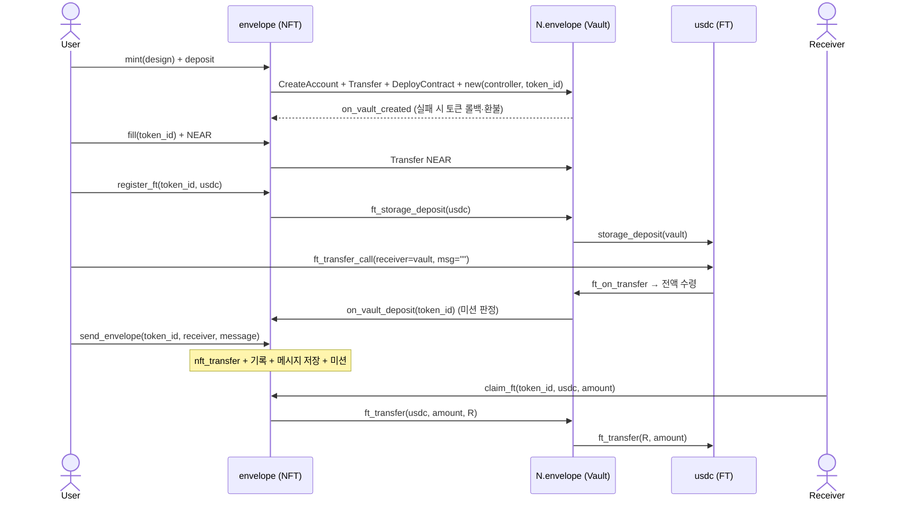

# Architecture

## 계정 구조

```
nearenvelope.testnet                 Envelope NFT 컨트랙트 (NEP-171/177/178/181)
├── 1.nearenvelope.testnet           Vault 컨트랙트 (Access Key 없음, controller = nearenvelope.testnet)
├── 2.nearenvelope.testnet
└── ...
usdc.nearenvelope.testnet            Mock USDC (NEP-141, decimals 6)
```

- NEAR에서 `x.parent` 계정은 `parent`만 만들 수 있다. 그래서 하위 계정 생성은 반드시 NFT 컨트랙트가 `mint` 안에서 한다.
- Vault wasm은 `envelope` 컨트랙트에 `include_bytes!`로 포함해 배포한다. (여유 시 Global Contract로 교체: `docs/DECISIONS.md` 참고)

## 보안 모델: 소유권 = 제어권

| 위협 | 대응 |
|---|---|
| 이전 소유자가 NFT를 넘긴 뒤 Vault 자산을 인출 | Vault에 Access Key 없음. 모든 출금은 `envelope.claim_*`만 거치고, 여기서 `predecessor == 현재 owner` 확인 |
| 누군가 Vault를 직접 호출 | Vault의 모든 변경 메서드는 `predecessor == controller` 확인 |
| Vault 계정 잔액이 스토리지 비용 아래로 떨어짐 | Vault `withdraw_near`가 `storage_usage * storage_byte_cost` + 여유분을 예약 |
| 강화 난수 조작 | `env::random_seed()` 사용. 검증자 수준 조작 가능성은 README에 한계로 명시 (향후 VRF) |
| 마켓 판매 직전 판매자가 자산 인출 | MVP 범위 밖. 여유 시 approval이 있는 동안 claim 잠금 |

## 주요 흐름



## 강화·희귀도

- 레벨 `0..=10`. 강화 1회에 티켓 1장 소모.
- 성공 시 +1, 실패 시 유지 (MVP는 하락·파괴 없음).
- 확률표와 희귀도 구간은 `docs/INTERFACE.md`에 정의. 값 변경은 B 소유 `enhance.rs`에서만.

## 데이터 저장 위치

| 데이터 | 위치 |
|---|---|
| 소유자, NEP-177 메타데이터 | `NonFungibleToken` (near-contract-standards) |
| 레벨, 티켓, 미션, 메시지, 전달 기록 | `envelopes: LookupMap<TokenId, EnvelopeState>` |
| 자산 잔액 | Vault 계정 자체 (프런트가 RPC `view_account` / `ft_balance_of`로 조회) |
